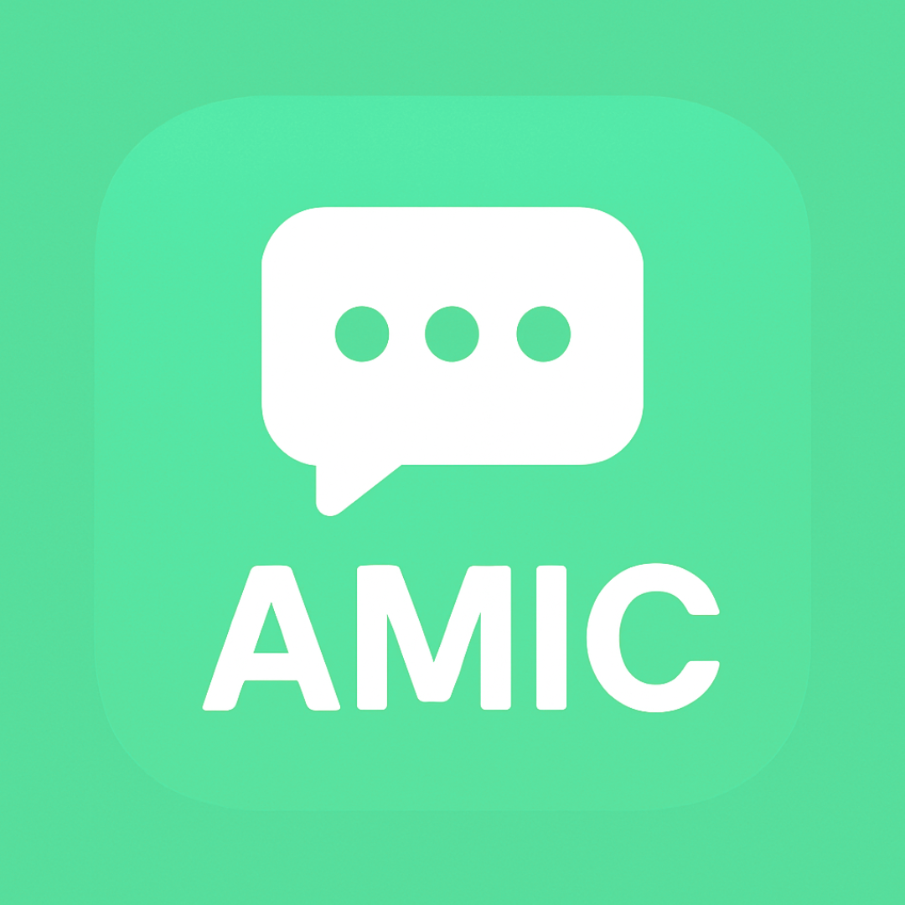
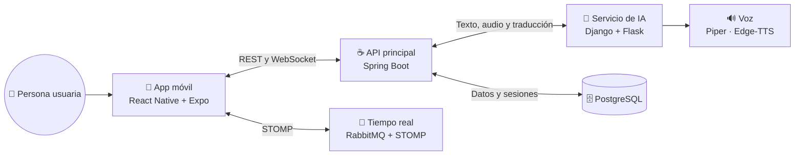

<div align="center">



# UniVoice

**Mensajería móvil que se adapta a cada persona.**

UniVoice es una aplicación de chat inclusiva que combina inteligencia artificial, voz y accesibilidad para que nadie se quede fuera de la conversación.

<br />


</div>

---

## Índice

- [¿Qué es UniVoice?](#qué-es-univoice)
- [Cómo funciona](#cómo-funciona)
- [Arquitectura](#arquitectura)
- [Funcionalidades](#funcionalidades)
- [Idiomas](#idiomas)
- [Tecnologías](#tecnologías)
- [Estructura del proyecto](#estructura-del-proyecto)
- [Puesta en marcha](#puesta-en-marcha)
- [Pruebas y calidad](#pruebas-y-calidad)
- [Despliegue](#despliegue)
- [Próximas mejoras](#próximas-mejoras)

---

## ¿Qué es UniVoice?

Hablar con otras personas debería ser sencillo para todo el mundo. Sin embargo, quienes tienen una discapacidad visual, auditiva o del habla se encuentran a diario con aplicaciones que no están pensadas para ellas. UniVoice nace para cambiar eso.

La plataforma adapta la conversación a la forma en que cada persona se comunica. Si alguien no puede leer con facilidad, el mensaje se convierte en voz. Si alguien no puede oír, la voz se transforma en texto. Si prefiere escribir en otro idioma, la traducción ocurre de forma casi instantánea. Todo sucede dentro del mismo chat, sin configuraciones complicadas y sin pedirle a la persona que se adapte a la tecnología: es la tecnología la que se adapta a ella.

El proyecto reúne una aplicación móvil, un servidor de mensajería y un servicio de inteligencia artificial que trabajan juntos. Cada pieza puede evolucionar por su cuenta, lo que facilita el mantenimiento y abre la puerta a nuevas funciones sin romper lo que ya existe.

---

## Cómo funciona

El recorrido de un mensaje es bastante directo:

1. **La persona habla o escribe.** La aplicación recoge el audio o el texto desde el móvil.
2. **El servicio de IA interpreta.** Whisper transcribe el audio, se detecta el idioma y, si hace falta, se traduce o se corrige la ortografía.
3. **El servidor organiza la conversación.** Spring Boot guarda los mensajes, gestiona las cuentas y distribuye los eventos en tiempo real.
4. **La respuesta se adapta.** Edge-TTS o Piper convierten el texto en una voz natural, y el mensaje llega a la otra persona en el formato que mejor le funcione.

Nada de esto requiere pasos extra por parte de quien usa la app. La accesibilidad está integrada en el flujo normal de la conversación.

---

## Arquitectura

El sistema sigue un modelo modular: la app móvil se comunica con la API principal, la API conversa con el servicio de IA y la mensajería en tiempo real se apoya en RabbitMQ.



| Módulo | Rol dentro del sistema |
| :--- | :--- |
| **`appchatmovil`** | La cara visible del proyecto. Ofrece el chat, la grabación de audio, la reproducción de voz y los ajustes de accesibilidad desde el móvil. |
| **`apiapplication`** | El núcleo de la plataforma. Gestiona usuarios, autenticación, historial de mensajes, archivos y la comunicación en tiempo real. |
| **`apidjango`** | El motor de inteligencia artificial. Transcribe audio, detecta idiomas, traduce textos y genera voz con distintos motores. |
| **`deploysprojects`** | Recursos para llevar el sistema a un entorno real: Docker, Nginx, RabbitMQ y scripts de despliegue. |
| **`encrypted`** | Espacio de trabajo para el módulo de cifrado y protección de la información. |

---

## Funcionalidades

| Función | Qué aporta |
| :--- | :--- |
| **Texto que se escucha** | Los mensajes se convierten en audio para quienes tienen discapacidad visual o prefieren escuchar en lugar de leer. |
| **Voz que se lee** | La transcripción convierte las notas de audio en texto para personas con discapacidad auditiva. |
| **Voz natural** | Piper funciona en local y Edge-TTS aprovecha la nube, de modo que siempre hay una opción disponible para generar voz. |
| **Traducción integrada** | Los modelos de Transformers traducen los mensajes y reducen la barrera del idioma dentro del chat. |
| **Corrección ortográfica** | Los textos se revisan antes de enviarse para que el mensaje llegue claro y bien escrito. |
| **Control por voz** | Las personas pueden navegar y enviar mensajes sin usar las manos. |
| **Diseño accesible** | La interfaz sigue criterios de contraste, tamaño de letra y legibilidad alineados con WCAG 2.1. |
| **Interfaz multilingüe** | La app está preparada para cambiar de idioma sin salir de la conversación. |

---

## Idiomas

La aplicación admite estos idiomas según el tipo de contenido:

**Interfaz gráfica y mensajes de texto:** disponibles en 14 idiomas: alemán, chino, coreano, español, francés, hindi, indonesio, inglés, italiano, japonés, portugués, ruso, turco y vietnamita.

**Mensajes de audio:** la transcripción y la síntesis de voz solo están disponibles en inglés y español.

---

## Tecnologías

| Capa | Herramientas | Para qué se usan |
| :--- | :--- | :--- |
| **Aplicación móvil** | React Native, Expo, TypeScript, Expo Router | Interfaz multiplataforma, navegación y experiencia de chat. |
| **Backend principal** | Java 17, Spring Boot, Maven, Spring Data JPA, Hibernate | API REST, autenticación, persistencia y WebSocket. |
| **Servicio de IA** | Python, Django, Flask, PyTorch, Transformers | Transcripción, traducción, detección de idioma y procesamiento de audio. |
| **Voz** | Whisper, Piper TTS, Edge-TTS, FFmpeg | Conversión entre voz y texto con respuesta natural. |
| **Datos y mensajería** | PostgreSQL, Flyway, RabbitMQ, STOMP | Almacenamiento seguro, migraciones y comunicación en tiempo real. |
| **Infraestructura** | Docker, Docker Compose, Nginx | Despliegue reproducible y distribución de tráfico. |
| **Calidad** | Pytest, JUnit, JMeter | Pruebas unitarias, de integración y de carga. |

---

## Estructura del proyecto

```text
proyecto/
├── apiapplication/       # API principal en Java con Spring Boot
├── apidjango/            # Servicio de IA y voz en Python (Django + Flask)
├── appchatmovil/         # Aplicación móvil en React Native / Expo
├── deploysprojects/      # Docker, Nginx y configuración de despliegue
├── encrypted/            # Trabajo en curso del módulo de cifrado
└── README.md             # Este documento
```

---

## Puesta en marcha

### Lo que necesitas antes de empezar

- **Node.js 18 o superior** con npm, además de Expo CLI.
- **JDK 17 o superior** y **Maven** para el backend.
- **Python 3.10 o superior** con pip para el servicio de IA.
- **PostgreSQL** en ejecución con una base de datos disponible.
- **FFmpeg**, necesario para procesar los archivos de audio.
- **Docker** (opcional, pero recomendable) si quieres levantar RabbitMQ sin instalar nada más.

> La API principal escucha en el puerto **8082** y Django en el **8000**. Si cambias estos valores, recuerda actualizar la configuración de la app móvil.

### 1. Arrancar la aplicación móvil

```bash
cd appchatmovil
npm install
npx expo start
```

Desde el menú de Expo puedes abrir la app en un emulador, en un dispositivo físico con Expo Go o en el navegador.

### 2. Arrancar la API principal

Antes de iniciar el servicio, revisa la conexión a PostgreSQL en `apiapplication/src/main/resources/application.properties`.

```bash
cd apiapplication
mvn clean install
java -jar target/apiamic-0.0.1-SNAPSHOT.jar
```

También puedes ejecutarlo directamente con Maven:

```bash
mvn spring-boot:run
```

### 3. Arrancar el servicio de inteligencia artificial

```bash
cd apidjango
venv\Scripts\activate
python apiconversion/manage.py runserver
```

En macOS o Linux, la activación del entorno virtual cambia ligeramente:

```bash
source venv/bin/activate
```

Si necesitas el servicio de voz basado en Flask, puedes iniciarlo con `active_service_flask.bat` en Windows o ejecutando `serviceFlaskTTS.py` con Python.

### 4. Levantar la mensajería en tiempo real

RabbitMQ se encarga de distribuir los eventos del chat. La forma más rápida de tenerlo listo es con Docker Compose:

```bash
cd deploysprojects
docker compose up -d
```

El contenedor habilita los plugins de administración, STOMP y Web-STOMP que necesita la aplicación.

### ¿Prefieres configurar cada servicio a mano?

- Instala PostgreSQL y crea una base de datos acorde a la URL definida en `application.properties`.
- Verifica que las credenciales de usuario y contraseña coincidan con tu instalación local.
- Instala las dependencias de Python desde `apidjango/apiconversion/requirements.txt` con `pip install -r requirements.txt`.
- Descarga los modelos de voz de Piper en la carpeta `apidjango/piper` si vas a usar la síntesis local.
- Comprueba que FFmpeg esté disponible en el `PATH` del sistema.

---

## Pruebas y calidad

La calidad se trabaja en tres frentes:

- **Pytest** cubre la lógica del servicio de IA: conversión de audio, traducción y generación de voz.
- **JUnit** valida los componentes del backend de Spring Boot.
- **JMeter** mide el comportamiento del sistema bajo carga con escenarios de prueba.

Para ejecutar las pruebas del backend:

```bash
cd apiapplication
mvn test
```

Y para las pruebas del servicio de IA:

```bash
cd apidjango
pytest
```

---

## Despliegue

La carpeta `deploysprojects` contiene todo lo necesario para desplegar la plataforma en un servidor:

- Un **Dockerfile** y un **docker-compose.yml** para RabbitMQ.
- Una configuración de **Nginx** como punto de entrada.
- El **JAR** de la API principal listo para ejecutarse.
- La carpeta `completedeploy-vfV1`, que reúne los servicios en una sola composición de Docker.

El flujo habitual consiste en compilar el backend con Maven, copiar el JAR a la carpeta de despliegue y levantar los servicios con Docker Compose. Nginx se encarga de redirigir las peticiones y de mantener una única puerta de entrada al sistema.

---

## Próximas mejoras

UniVoice sigue creciendo. Esto es lo que falta por construir:

- [ ] **Chat grupal:** conversaciones con varias personas, manteniendo la transcripción y la síntesis de voz en cada mensaje.
- [ ] **Cifrado de extremo a extremo:** Mejora de módulos de cifrado para reforzar la privacidad de las conversaciones.
- [ ] **Interfaz más intuitiva:** revisión de pantallas y componentes para que la navegación resulte natural desde el primer uso.
- [ ] **Traducción más precisa:** modelos actualizados que reduzcan la latencia y entiendan mejor el contexto de cada conversación.
- [ ] **Idiomas en los audios:** ampliar la transcripción y la síntesis de voz a más idiomas, comenzando por los que ya ofrece la interfaz.

---

<div align="center">

<br />

**Hecho con la convicción de que comunicarse es un derecho, no un privilegio.**

<sub>UniVoice · Proyecto de mensajería accesible</sub>

</div>
