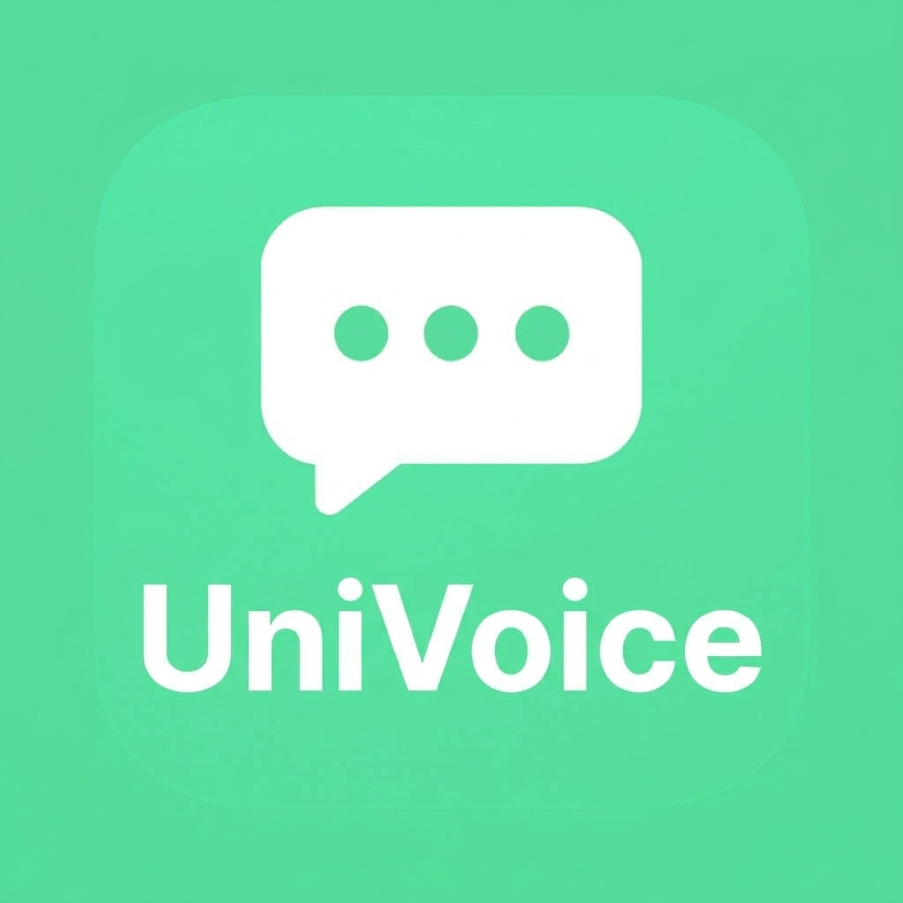
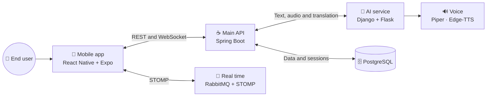

<div align="center">



# UniVoice

**Mobile messaging that adapts to every person.**

UniVoice is an inclusive chat application that combines artificial intelligence, voice and accessibility so that no one is left out of the conversation.

<br />


</div>

---

## Table of contents

- [What is UniVoice?](#what-is-univoice)
- [How it works](#how-it-works)
- [Architecture](#architecture)
- [Features](#features)
- [Languages](#languages)
- [Technologies](#technologies)
- [Project structure](#project-structure)
- [Getting started](#getting-started)
- [Testing and quality](#testing-and-quality)
- [Deployment](#deployment)
- [Upcoming improvements](#upcoming-improvements)

---

## What is UniVoice?

Talking to other people should be simple for everyone. However, people with visual, hearing or speech disabilities come across applications every day that were not designed with them in mind. UniVoice was born to change that.

The platform adapts the conversation to the way each person communicates. If someone cannot read easily, the message is turned into voice. If someone cannot hear, the voice is turned into text. If they prefer to write in another language, the translation happens almost instantly. Everything takes place inside the same chat, without complicated settings and without asking the person to adapt to the technology: it is the technology that adapts to them.

The project brings together a mobile application, a messaging server and an artificial intelligence service that work side by side. Each piece can evolve on its own, which makes maintenance easier and opens the door to new features without breaking what already exists.

---

## How it works

The journey of a message is quite straightforward:

1. **The person speaks or writes.** The application captures the audio or the text from the mobile device.
2. **The AI service interprets it.** Whisper transcribes the audio, the language is detected and, if needed, the text is translated or its spelling is corrected.
3. **The server organises the conversation.** Spring Boot stores the messages, manages the accounts and distributes the events in real time.
4. **The response adapts.** Edge-TTS or Piper turn the text into a natural voice, and the message reaches the other person in the format that works best for them.

None of this requires extra steps from the person using the app. Accessibility is built into the normal flow of the conversation.

---

## Architecture

The system follows a modular model: the mobile app communicates with the main API, the API talks to the AI service and real-time messaging relies on RabbitMQ.



| Module | Role within the system |
| :--- | :--- |
| **`appchatmovil`** | The visible face of the project. It provides the chat, audio recording, voice playback and accessibility settings from the mobile device. |
| **`apiapplication`** | The core of the platform. It manages users, authentication, message history, files and real-time communication. |
| **`apidjango`** | The artificial intelligence engine. It transcribes audio, detects languages, translates texts and generates voice with different engines. |
| **`deploysprojects`** | Resources for taking the system to a real environment: Docker, Nginx, RabbitMQ and deployment scripts. |
| **`encrypted`** | Workspace for the encryption and information protection module. |

---

## Features

| Feature | What it brings |
| :--- | :--- |
| **Text you can hear** | Messages are turned into audio for people with visual disabilities or for those who prefer listening to reading. |
| **Voice you can read** | Transcription turns voice notes into text for people with hearing disabilities. |
| **Natural voice** | Piper runs locally and Edge-TTS takes advantage of the cloud, so there is always an available option for generating voice. |
| **Built-in translation** | Transformer models translate the messages and lower the language barrier inside the chat. |
| **Spelling correction** | Texts are checked before being sent so that the message arrives clear and well written. |
| **Voice control** | People can navigate and send messages without using their hands. |
| **Accessible design** | The interface follows contrast, font size and legibility criteria aligned with WCAG 2.1. |
| **Multilingual interface** | The app is ready to switch languages without leaving the conversation. |

---

## Languages

The application supports these languages depending on the type of content:

**Graphical interface and text messages:** available in 14 languages: German, Chinese, Korean, Spanish, French, Hindi, Indonesian, English, Italian, Japanese, Portuguese, Russian, Turkish and Vietnamese.

**Audio messages:** transcription and speech synthesis are only available in English and Spanish.

---

## Technologies

| Layer | Tools | What they are used for |
| :--- | :--- | :--- |
| **Mobile application** | React Native, Expo, TypeScript, Expo Router | Cross-platform interface, navigation and chat experience. |
| **Main backend** | Java 17, Spring Boot, Maven, Spring Data JPA, Hibernate | REST API, authentication, persistence and WebSocket. |
| **AI service** | Python, Django, Flask, PyTorch, Transformers | Transcription, translation, language detection and audio processing. |
| **Voice** | Whisper, Piper TTS, Edge-TTS, FFmpeg | Conversion between voice and text with natural-sounding output. |
| **Data and messaging** | PostgreSQL, Flyway, RabbitMQ, STOMP | Secure storage, migrations and real-time communication. |
| **Infrastructure** | Docker, Docker Compose, Nginx | Reproducible deployment and traffic distribution. |
| **Quality** | Pytest, JUnit, JMeter | Unit, integration and load testing. |

---

## Project structure

```text
project/
├── apiapplication/       # Main API in Java with Spring Boot
├── apidjango/            # AI and voice service in Python (Django + Flask)
├── appchatmovil/         # Mobile application in React Native / Expo
├── deploysprojects/      # Docker, Nginx and deployment configuration
├── encrypted/            # Work in progress on the encryption module
└── README.md             # This document
```

---

## Getting started

### What you need before you start

- **Node.js 18 or higher** with npm, plus Expo CLI.
- **JDK 17 or higher** and **Maven** for the backend.
- **Python 3.10 or higher** with pip for the AI service.
- **PostgreSQL** running with an available database.
- **FFmpeg**, required to process the audio files.
- **Docker** (optional, but recommended) if you want to run RabbitMQ without installing anything else.

> The main API listens on port **8082** and Django on **8000**. If you change these values, remember to update the mobile app configuration.

### 1. Start the mobile application

```bash
cd appchatmovil
npm install
npx expo start
```

From the Expo menu you can open the app in an emulator, on a physical device with Expo Go or in the browser.

### 2. Start the main API

Before starting the service, check the PostgreSQL connection in `apiapplication/src/main/resources/application.properties`.

```bash
cd apiapplication
mvn clean install
java -jar target/apiamic-0.0.1-SNAPSHOT.jar
```

You can also run it directly with Maven:

```bash
mvn spring-boot:run
```

### 3. Start the artificial intelligence service

```bash
cd apidjango
venv\Scripts\activate
python apiconversion/manage.py runserver
```

On macOS or Linux, activating the virtual environment is slightly different:

```bash
source venv/bin/activate
```

If you need the Flask-based voice service, you can start it with `active_service_flask.bat` on Windows or by running `serviceFlaskTTS.py` with Python.

### 4. Bring up real-time messaging

RabbitMQ is in charge of distributing the chat events. The quickest way to have it ready is with Docker Compose:

```bash
cd deploysprojects
docker compose up -d
```

The container enables the administration, STOMP and Web-STOMP plugins that the application needs.

### Would you rather configure each service by hand?

- Install PostgreSQL and create a database matching the URL defined in `application.properties`.
- Make sure the user and password credentials match your local installation.
- Install the Python dependencies from `apidjango/apiconversion/requirements.txt` with `pip install -r requirements.txt`.
- Download the Piper voice models into the `apidjango/piper` folder if you are going to use local synthesis.
- Check that FFmpeg is available in the system `PATH`.

---

## Testing and quality

Quality is addressed from three angles:

- **Pytest** covers the logic of the AI service: audio conversion, translation and voice generation.
- **JUnit** validates the components of the Spring Boot backend.
- **JMeter** measures how the system behaves under load with test scenarios.

To run the backend tests:

```bash
cd apiapplication
mvn test
```

And for the AI service tests:

```bash
cd apidjango
pytest
```

---

## Deployment

The `deploysprojects` folder contains everything needed to deploy the platform on a server:

- A **Dockerfile** and a **docker-compose.yml** for RabbitMQ.
- An **Nginx** configuration acting as the entry point.
- The main API **JAR** ready to run.
- The `completedeploy-vfV1` folder, which brings the services together in a single Docker composition.

The usual flow consists of building the backend with Maven, copying the JAR to the deployment folder and bringing the services up with Docker Compose. Nginx takes care of redirecting the requests and keeping a single entry point to the system.

---

## Upcoming improvements

UniVoice keeps growing. This is what is still left to build:

- [ ] **Group chat:** conversations with several people, keeping transcription and speech synthesis on every message.
- [ ] **End-to-end encryption:** improvement of the encryption modules to strengthen the privacy of the conversations.
- [ ] **More intuitive interface:** review of screens and components so that navigation feels natural from the very first use.
- [ ] **More accurate translation:** updated models that reduce latency and understand the context of each conversation better.
- [ ] **More languages in audio:** extend transcription and speech synthesis to more languages, starting with those already offered by the interface.

---

<div align="center">

<br />

**Made with the conviction that communicating is a right, not a privilege.**

<sub>UniVoice · Accessible messaging project</sub>

</div>
